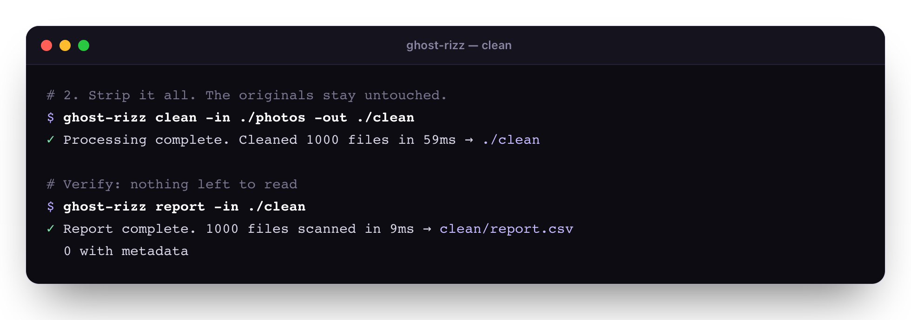
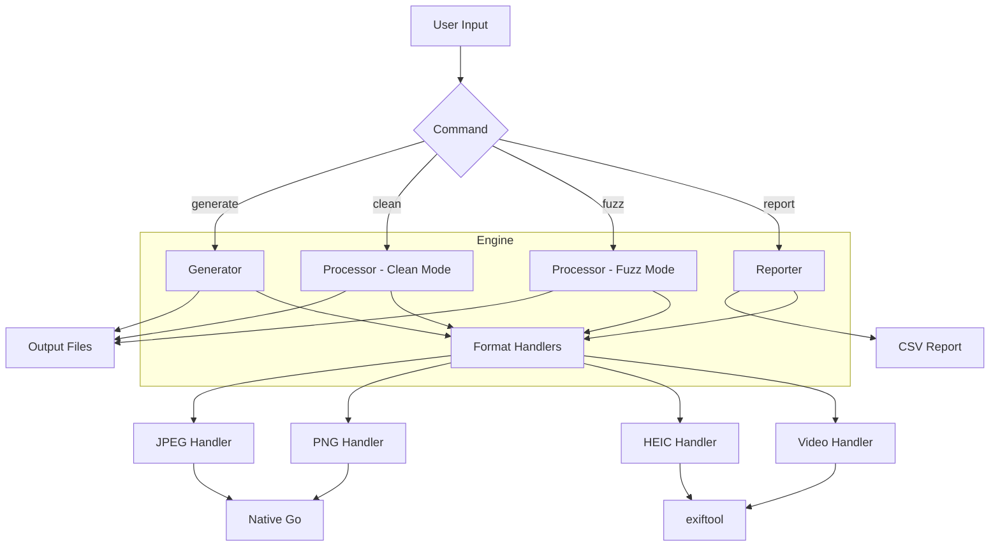
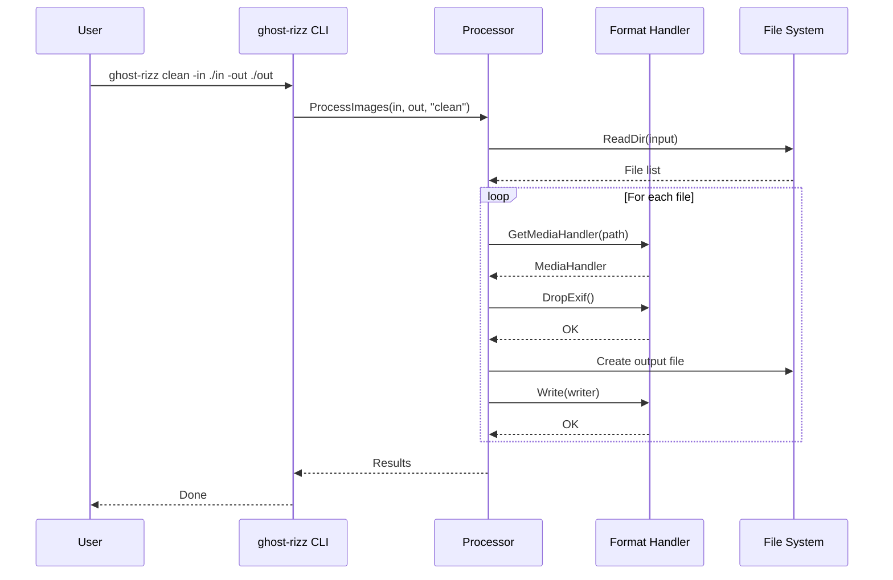
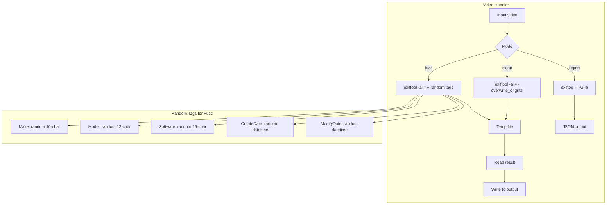
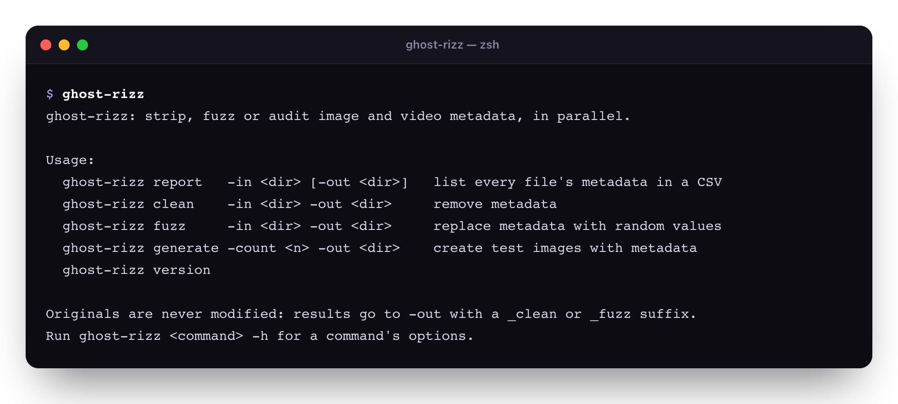
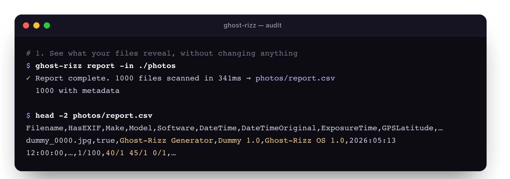
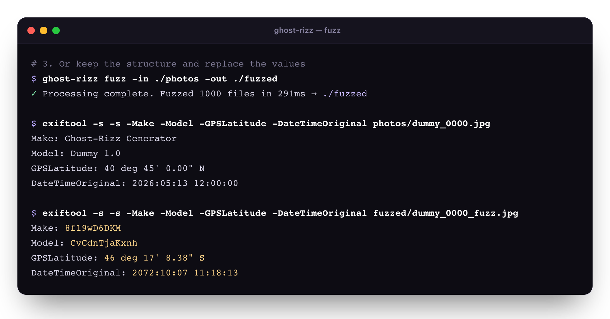
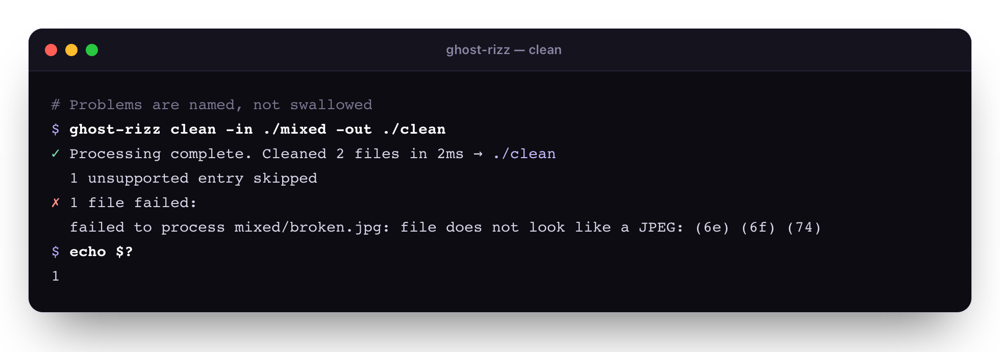

# ghost-rizz

**Concurrent EXIF metadata cleaner and fuzzer, written in pure Go.**
Strip, fuzz or audit the metadata of thousands of images per second.



## Why this exists

Modern images carry a metadata shadow: device, GPS, software, timestamps,
owner. Useful for editors and archives; leaky for people publishing photos
in public. `ghost-rizz` gives you three operations, at scale:

- **`clean`** — strip the EXIF segment entirely.
- **`fuzz`** — keep the structure, randomize the values (Make, Model,
  Software, DateTime, GPS, ExposureTime). Useful for testing metadata
  ingestion pipelines or breaking naive fingerprinting.
- **`report`** — extract every tag to CSV for audit.

Single static binary. Zero runtime dependencies (except `exiftool` for
HEIC and video formats — see below).

## How it works

### High-level architecture



### Command flow

```mermaid
flowchart LR
    subgraph Generate
        G1[ghost-rizz generate] --> G2[Create dummy images]
        G2 --> G3[Inject EXIF via exifutil]
        G3 --> G4[Write JPEG/PNG]
    end
    
    subgraph Clean
        CL1[ghost-rizz clean] --> CL2[Scan input dir]
        CL2 --> CL3[Filter supported formats]
        CL3 --> CL4[Worker pool]
        CL4 --> CL5[Format handler]
        CL5 --> CL6[DropExif]
        CL6 --> CL7[Write output]
    end
    
    subgraph Fuzz
        FZ1[ghost-rizz fuzz] --> FZ2[Scan input dir]
        FZ2 --> FZ3[Filter supported formats]
        FZ3 --> FZ4[Worker pool]
        FZ4 --> FZ5[Format handler]
        FZ5 --> FZ6[SetExif random]
        FZ6 --> FZ7[Write output]
    end
    
    subgraph Report
        RP1[ghost-rizz report] --> RP2[Scan input dir]
        RP2 --> RP3[Filter supported formats]
        RP3 --> RP4[Worker pool]
        RP4 --> RP5[Format handler]
        RP5 --> RP6[RawExif]
        RP6 --> RP7[Parse EXIF tags]
        RP7 --> RP8[CSV output]
    end
```



### Internal processing pipeline



### Video format processing (delegates to exiftool)



## Install

**Prebuilt binaries.** Every [release](https://github.com/ThothandSon/ghost-rizz/releases/latest) has archives for macOS (one universal binary for Apple silicon and Intel), Linux and Windows, on amd64 and arm64, plus `checksums.txt`.

```bash
# macOS, from the v1.0.0 release; other platforms use _linux_amd64, _linux_arm64 or _windows_*.zip
curl -LO https://github.com/ThothandSon/ghost-rizz/releases/download/v1.0.0/ghost-rizz_1.0.0_darwin_all.tar.gz
tar xzf ghost-rizz_1.0.0_darwin_all.tar.gz
sudo mv ghost-rizz /usr/local/bin/
```

**With Go** (1.24+):

```bash
go install github.com/ThothandSon/ghost-rizz/cmd/ghost-rizz@latest
```

**From source:**

```bash
git clone https://github.com/ThothandSon/ghost-rizz
cd ghost-rizz
go build -o ghost-rizz ./cmd/ghost-rizz
```

HEIC and video files need [`exiftool`](https://exiftool.org) on your `PATH` (`brew install exiftool`, `apt install libimage-exiftool-perl`). JPEG and PNG need nothing else.

## Walkthrough

Running `ghost-rizz` with no arguments shows what it can do:



### 1. Audit before you change anything

`report` reads every supported file in a folder and writes one CSV row per file. Nothing is modified. Here the camera make, model and GPS position are exactly what you'd want to remove before publishing.



By default `report.csv` lands in the folder you scanned, so a later `clean` of that folder mentions it as one skipped entry. Use `-out` to put reports elsewhere.

### 2. Strip it all

`clean` writes metadata-free copies to the output folder with a `_clean` suffix. Running `report` on the result is the quickest proof that nothing readable is left.


### 3. Or replace it with noise

`fuzz` keeps the metadata structure and swaps the values for random ones: useful for testing ingestion pipelines, or for breaking naive fingerprinting.



### 4. When something fails

Unsupported files are counted and skipped. Files that can't be processed are named with the reason, and the exit code is 1, so scripts can tell.



### Test data

`generate` creates JPEG and PNG images with realistic metadata, so you can try everything above without touching your own photos:

```bash
ghost-rizz generate -count 1000 -out ./photos
```

## Commands

### `generate` — procedural test images

Creates unique-colored JPEGs with realistic EXIF injected (Make, Model,
Software, GPS, ExposureTime, DateTime). Meant for testing your pipeline.

```
ghost-rizz generate -count 1000 -out ./input_photos
```

### `clean` / `fuzz` — modify metadata

```
ghost-rizz clean -in ./input -out ./output    # strip EXIF entirely
ghost-rizz fuzz  -in ./input -out ./output    # randomize EXIF values
```

Output files are suffixed automatically: `photo_clean.jpg`, `photo_fuzz.jpg`.
The original folder is never touched.

> **Historical note:** in versions ≤ v0.9 both operations were under the
> `fuzz` subcommand with `-mode`. From v1.0 they're independent verbs. The
> old form still works.

### `report` — audit CSV

```
ghost-rizz report -in ./photos               # writes photos/report.csv
ghost-rizz report -in ./photos -out ./out    # writes out/report.csv
```

Always run `report` before `clean` or `fuzz`. It's non-destructive and
tells you exactly what you're about to delete.

## Supported formats

| Format | Support | Notes |
|---|---|---|
| **JPEG** (`.jpg`, `.jpeg`) | Native, fast | Full read/write |
| **PNG** (`.png`) | Native, fast | Reads `tEXt`/`iTXt` chunks |
| **HEIC / HEIF** (`.heic`, `.heif`) | Delegates to `exiftool` | Requires `exiftool` installed. HEIC `fuzz` currently only randomizes Make, Model, Software. |
| **MP4** (`.mp4`) | Delegates to `exiftool` | Requires `exiftool` installed. Full clean/fuzz/report support. |
| **MOV** (`.mov`) | Delegates to `exiftool` | Requires `exiftool` installed. Full clean/fuzz/report support. |
| **MKV** (`.mkv`) | Delegates to `exiftool` | Requires `exiftool` installed. Full clean/fuzz/report support. |
| **AVI** (`.avi`) | Delegates to `exiftool` | Requires `exiftool` installed. Full clean/fuzz/report support. |
| **WebM** (`.webm`) | Delegates to `exiftool` | Requires `exiftool` installed. Full clean/fuzz/report support. |
| **M4V** (`.m4v`) | Delegates to `exiftool` | Requires `exiftool` installed. Full clean/fuzz/report support. |
| **3GP** (`.3gp`) | Delegates to `exiftool` | Requires `exiftool` installed. Full clean/fuzz/report support. |

## Benchmark

1 000 JPEGs on a standard machine (Apple M2, NVMe, macOS 15):

| Operation | Time |
|---|---|
| `generate` (create with EXIF) | ~3.02 s |
| `clean` (strip 1 000 files) | **~0.19 s** |
| `fuzz` (randomize 1 000 files) | ~0.66 s |
| `report` (CSV of 1 000 files) | ~0.88 s |

Scaling is linear via `sync.WaitGroup`; hundreds of thousands of images
finish in seconds. The bottleneck is disk I/O, not CPU. Run
`./run_benchmark.sh` on your own hardware to reproduce.

## Threat model in one paragraph

`ghost-rizz` protects the metadata that is visible to a program reading
the file with a standard EXIF/XMP/IPTC parser. It **does not** hide
information encoded in the pixels (steganography), **does not** touch
embedded JPEG thumbnails smaller than the main image (some tools use them
to leak the pre-crop), **does not** guarantee anonymity against traffic
analysis or platform-side profiling, and **is not** a substitute for
end-to-end encryption. Read [`SECURITY.md`](./SECURITY.md) for the full
model and known limitations.

## Testing

```
go test ./...
go test ./... -coverprofile=cov.out && go tool cover -func=cov.out
```

Coverage is enforced at 85% by CI. Contributions welcome — see the
[issues](https://github.com/ThothandSon/ghost-rizz/issues) tab.

## When `ghost-rizz` is not enough

- **You need PDF, DOCX, RAW or exotic formats** —
  [`exiftool`](https://exiftool.org) by Phil Harvey has 20 years of
  coverage `ghost-rizz` will never match. Use `exiftool` for those cases;
  use `ghost-rizz` for the JPEG/PNG/HEIC/Video hot path.

## License

MIT © 2026 Thoth & Son. See [`LICENSE`](./LICENSE).
